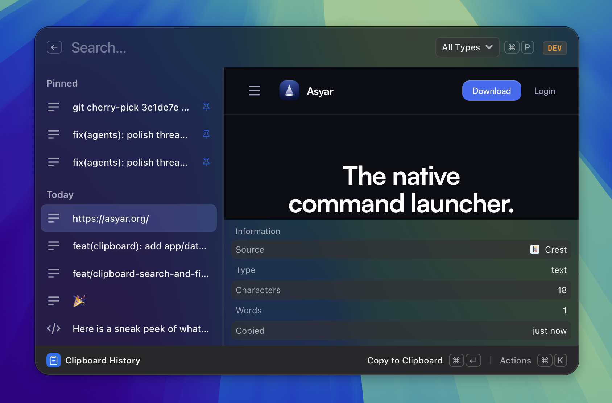
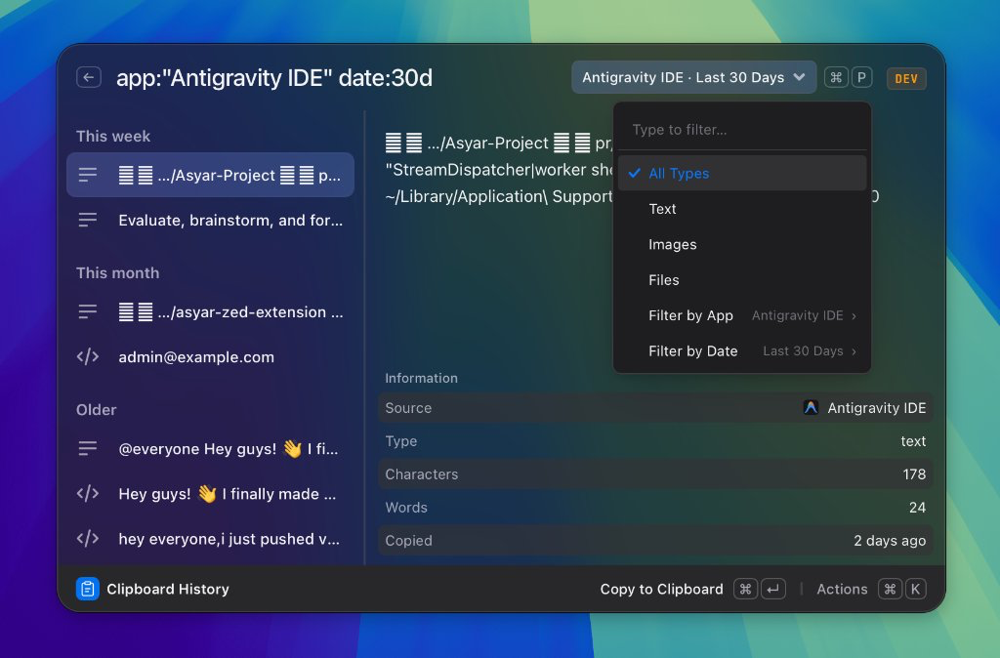

# Clipboard History

> Browse, filter, favorite, and paste past copies.

_Figure: the clipboard list with the type filter visible._

## What it does

Clipboard History records everything you copy — text, rich text (HTML/RTF), images, and file paths — and lets you browse, search, filter, and paste any past entry. Favourited items are pinned at the top and survive the "clear history" action.

The list is grouped by time: Pinned, Today, Yesterday, This Week, This Month, Older. The detail pane on the right shows a full preview: plain text renders with Markdown highlighting, HTML can be viewed rendered or as raw source, images are shown as thumbnails, and copied URLs can be previewed inline.

Asyar also records which app each item came from, so you can see the source application (and window title) at the bottom of the detail pane.

## How to use it

1. Open Asyar and type `clip` — or select **Clipboard History** from search results.
2. The clipboard view opens. Use `↑` / `↓` to move through the list.
3. Type in the search bar to filter. Full-text search runs across all text entries as well as the **source application** (app name, bundle ID, and window title), and handles URLs, file paths, and punctuation (`/`, `-`) cleanly.
4. To filter across your **entire stored history** by **Type**, **Source App**, or **Date**, click the dropdown in the search bar (or press `⌘P` / `Ctrl+P`). Any filter you pick also appears as a token in the search bar.
5. Press `Enter` (`↵`) to paste the selected item into the app that was in focus before you opened Asyar, or `⌘↵` (`Ctrl+↵` on Windows/Linux) to copy it back to your clipboard without pasting.
6. Press `⌃⌘↵` (`Ctrl+Shift+↵` on Windows/Linux) to paste as plain text, stripping any formatting.
7. To paste several items at once, `⌘Click` (or `Ctrl+Click` on Windows/Linux) each item you want, or hold `⌘`/`Ctrl` and press `↑`/`↓` to sweep through a range — then press `Enter` to merge them into a single paste.

## Filtering & search tokens

_Figure: filtering clipboard history by source app and date range using `⌘P` and search tokens._

The filter menu (`⌘P`) and the search bar work together in both directions:

- **Pick in `⌘P` -> appears in the search bar**: Choosing **Images**, **Filter by App**, or **Filter by Date** in `⌘P` automatically adds or updates the matching token (like `type:images`, `app:"Antigravity IDE"`, or `date:30d`) in the search bar and returns focus to the input so you can keep typing.
- **Type in the search bar -> updates `⌘P`**: Typing or editing filter tokens directly in the search bar updates the checkmarks and button label (such as `Antigravity IDE · Last 30 Days`) inside `⌘P` in real time.
- **In-place submenus inside `⌘P`**: Choose **Filter by App** or **Filter by Date** (`Enter`, `→`, or click) to drill into that list in place. A `←` back header appears at the top — press `Esc`, `⌫` or `←` (when the filter box is empty), or click the `←` header to return to the main filter menu.

You can type any of these tokens directly in the search bar, alone or combined with search words (for example, `app:"Antigravity IDE" date:30d StreamDispatcher`):

| Token                                    | What it filters                                                    |
| ---------------------------------------- | ------------------------------------------------------------------ |
| `type:text`, `type:images`, `type:files` | Narrow results to text/rich text, images, or copied files          |
| `app:Safari`, `app:"Antigravity IDE"`    | Match items copied from an app by name or bundle ID (quote spaces) |
| `date:today`, `date:yesterday`           | Items copied today or yesterday                                    |
| `date:7d`, `date:30d`, `date:YYYY-MM-DD` | Items from the last 7 days, last 30 days, or a specific date       |
| `after:YYYY-MM-DD`, `after:7d`           | Items copied on or after the given date or relative window         |

When browsing without search words, filters run against your local SQLite history database before paging, so matching older entries remain available. Filtered text searches check only the highest-ranked full-text candidates (at least 1,000), then apply the filters. For common search terms, older matches outside that candidate set may be omitted.

## Shortcuts & actions

| Action                          | How                    |
| ------------------------------- | ---------------------- |
| Paste                           | `↵` (`Enter`)          |
| Filter by Type, App, or Date    | `⌘P` (`Ctrl+P`)        |
| Copy to Clipboard               | `⌘↵` (`Ctrl+↵`)        |
| Paste as Plain Text             | `⌃⌘↵` (`Ctrl+Shift+↵`) |
| Pin / Unpin (Toggle Favorite)   | `⌘.` (`Ctrl+.`)        |
| Rename Entry                    | `⇧⌘E` (`Ctrl+Shift+E`) |
| Open in Browser (URL items)     | `⌘O` (`Ctrl+O`)        |
| Save as Snippet                 | `⌘S` (`Ctrl+S`)        |
| Ask AI about this               | `⌘I` (`Ctrl+I`)        |
| Delete (with confirmation)      | `⌃X` (`Ctrl+X`)        |
| Clear History (with confirm)    | `⌃⇧X` (`Ctrl+Shift+X`) |
| Toggle an item in the selection | `⌘Click`               |
| Extend the selection            | `⌘↑` / `⌘↓`            |
| Merge & paste the selection     | `↵` (`Enter`)          |
| Open action panel               | `⌘K`                   |

**Action panel (⌘K) entries while the list is open:**

- **Paste** (`↵`) — pastes the selected item directly into the previously active app.
- **Copy to Clipboard** (`⌘↵`) — copies the selected item back to your system clipboard.
- **Paste as Plain Text** (`⌃⌘↵` / `Ctrl+Shift+↵`) — strips formatting before pasting.
- **Pin / Unpin** (`⌘.`) — pins or unpins the selected item. Favourites are never deleted by "Clear Clipboard History".
- **Rename Entry** (`⇧⌘E` / `Ctrl+Shift+E`) — sets a custom display title for the selected item. Custom titles appear in the list and detail preview, are indexed for full-text search, and leave the underlying raw content intact for pasting. To reset to the original preview title, save an empty name.
- **Toggle HTML Rendered / Source** — switches the detail pane between rendered HTML and raw source (useful for HTML or RTF items).
- **Open in Browser** (`⌘O`) — opens a selected URL item in your default browser.
- **Save as Snippet** (`⌘S`) — sends the selected text item directly to the Snippets editor so you can give it a keyword.
- **Delete** (`⌃X`) — asks for confirmation and removes the selected item permanently.
- **Clear Selection** — deselects all multi-selected items, without leaving the view. Only appears while a selection is active.
- **Ask AI about this** (`⌘I`) — opens AI Chat with the selected text pre-filled.
- **Clear Clipboard History** (`⌃⇧X`) — asks for confirmation and removes all non-favourited items (available from the root search bar too, without opening the view).

## Tips

- **Favourites survive clears** — star anything you want to keep forever before running "Clear Clipboard History".
- **Double-click to paste** — clicking an item selects it; double-clicking pastes it immediately.
- **RTF items** — Asyar stores the rich format but "Paste as Plain Text" strips it, which is handy for pasting into apps that don't accept rich text.
- **Large text is truncated in the preview** — the full content is always pasted correctly; the preview just caps at 50,000 characters to keep the UI fast.
- **Merged paste is plain text, in selection order** — `⌘Click`/`⌘↑`/`⌘↓` build an ordered multi-selection independent of the normal cursor, so browsing around with plain clicks or arrow keys never loses it. Pressing `Enter` joins every selected item's text with a newline and pastes it as one block, in the order you selected them. Images and files can't be merged as text and are skipped (you'll see a toast if any were).
- **Disabling Clipboard History** — You can turn off Clipboard History in **Settings → Extensions**. When disabled, background clipboard monitoring and capture immediately stop, active views are closed, and search contributions are hidden. Existing history is safely preserved and will reappear if re-enabled. Shared clipboard read/write actions used by other features continue to function normally.

## Automatic history retention (TTL)

To protect your privacy and keep your clipboard database lean, Asyar automatically purges older clipboard entries based on a configurable time-to-live (TTL).

- **Configurable retention periods** — In **Settings → Privacy → Clipboard Privacy**, you can choose how long items are kept before automatic eviction:
  - `1 minute`, `5 minutes`, `10 minutes` (for high-privacy or temporary scratchpad usage)
  - `1 hour`, `24 hours`, `7 days`, `30 days`
  - `90 days` (default)
- **Automatic eviction on capture** — Each time a new item is copied and captured, Asyar deletes non-favourited items that have aged past your selected retention window.
- **Favourites are protected** — Starred/favourited entries are strictly preserved and will never be automatically deleted by the retention timer.

## Related

- [The Basics](../the-basics.md)
- [Snippets](./snippets.md)
- [AI and Agents](./ai-and-agents.md)
