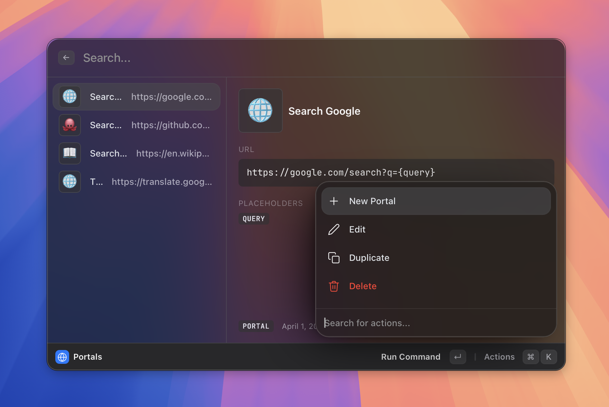

# Portals

> Save URLs, file/folder paths, and deeplinks as fast, searchable shortcuts.

_Figure: a portal result appearing in search._

## What it does

Portals turn the websites, search engines, local folders, and app deeplinks you open every day into named shortcuts you can run directly from the Asyar search bar.

A portal can be a web URL (`https://github.com`), a search URL with inline arguments (`https://google.com/search?q={argument name="Query"}`), a local file or folder path (`~/Projects`), or a deeplink (`spotify://...`). Portals appear directly in root search as soon as you type their name.

## How to use it

**To create a portal:**

1. Open Asyar, search for **Portals**, and press `Enter`, then press `⌘N` (or click **Add your first portal** when empty).
2. Enter the **Link** — a web URL, file/folder path (click the folder button to browse), or deeplink. When creating a new portal, Asyar can autofill the link from your active browser tab or clipboard.
3. To make the link dynamic, type `{` or click the placeholder button to insert placeholders like `{argument name="Query"}`, `{clipboard}`, `{selection}`, or `{date}`.
4. Enter a **Name & Icon**. For `http(s)://` links, Asyar fetches the site's favicon directly from its own origin and caches it locally (or you can pick an icon/emoji).
5. Optionally choose an **Open With** application and add comma-separated **Tags**.
6. Press `⌘↵` to save.

**To open a portal:**

1. Open Asyar and start typing the portal's name.
2. Static portals open immediately on `Enter`.
3. Portals with `{argument ...}` or `{query}` placeholders show inline argument chips (up to 3, including text fields and `options="..."` dropdowns). Press `Tab` to fill them in, then press `Enter` to open.

**To search, filter, and manage portals:**

Open **Portals** from root search:

- Type in the search bar to filter by name, link, or tag.
- Press `⌘P` to filter by tag (**All Tags** or a specific tag).
- Pinned portals stay at the top of the list, and the detail pane shows a live link preview along with **Name**, **Link**, **Open With**, **Tags**, **Created**, **Last Updated**, and **Opened** count.
- Press `⌘K` to open the Action Panel.

## Shortcuts & actions

| Action                      | How   |
| --------------------------- | ----- |
| Open selected portal        | `↵`   |
| New portal (in view)        | `⌘N`  |
| Filter by tag               | `⌘P`  |
| Edit portal                 | `⌘E`  |
| Duplicate portal            | `⌘D`  |
| Pin / Unpin portal          | `⌘⇧P` |
| Copy Name                   | `⌘⇧C` |
| Copy Link                   | `⌘⇧L` |
| Delete portal (confirm)     | `⌃X`  |
| Save / Update form          | `⌘↵`  |
| Cancel form / close popover | `Esc` |
| Open action panel           | `⌘K`  |

**Action panel (`⌘K`) entries inside the Portals view:**

- **Open Portal** (`↵`) — open the selected portal with its configured app (or system default).
- **Open With…** — choose a specific application to open the selected portal once.
- **Edit** (`⌘E`) — edit the portal's link, name/icon, Open With app, or tags.
- **Duplicate** (`⌘D`) — create a copy of the selected portal.
- **Pin Portal / Unpin Portal** (`⌘⇧P`) — keep frequently used portals at the top of the list.
- **Copy Name** (`⌘⇧C`) / **Copy Link** (`⌘⇧L`) — copy the portal's title or raw link template.
- **Hide in Root Search / Show in Root Search** — keep a portal out of root search while keeping it accessible inside **Portals**.
- **New Portal** (`⌘N`) — open the create-portal form.
- **Import Portals…** — import portals from a Raycast Quicklinks `.json` export file (`name`, `link`, `openWith`, `tags`), skipping duplicates.
- **Delete** (`⌃X`) — permanently remove the selected portal (with confirmation).

## Dynamic placeholders & modifiers

All placeholder values inserted into a URL are automatically percent-encoded unless `| raw` is specified.

| Placeholder                                            | What it does                                                                       |
| ------------------------------------------------------ | ---------------------------------------------------------------------------------- |
| `{argument}` / `{query}`                               | Inline text argument chip in root search                                           |
| `{argument name="Query"}`                              | Named argument chip; reuse the same `name` to fill multiple places from one chip   |
| `{argument name="tone" default="happy"}`               | Optional argument pre-filled with a default value                                  |
| `{argument name="tone" options="happy, sad, neutral"}` | Dropdown argument chip with predefined choices                                     |
| `{selection}` / `{Selected Text}`                      | Text currently selected in the frontmost app                                       |
| `{clipboard}` / `{Clipboard Text}`                     | Current text content of the clipboard                                              |
| `{uuid}` / `{UUID}`                                    | A randomly generated UUID v4                                                       |
| `{date}` / `{time}` / `{datetime}` / `{day}`           | Current date/time; supports `format="..."`, `offset="+1d -2h"`, and `locale="..."` |

**Modifiers:** append `| raw`, `| uppercase`, `| lowercase`, `| trim`, `| percent-encode`, or `| json-stringify` inside any placeholder (for example `{clipboard | trim | uppercase}` or `{argument name="path" | raw}`).

## Related

- [The Basics](../the-basics.md)
- [Aliases & Shortcuts](./aliases-and-shortcuts.md)
- [Browser Integration](./browser-integration.md)
- [Import from Raycast](./raycast-import.md) — import `.rayconfig` or Quicklinks JSON files with named arguments, `openWith`, and tags preserved
