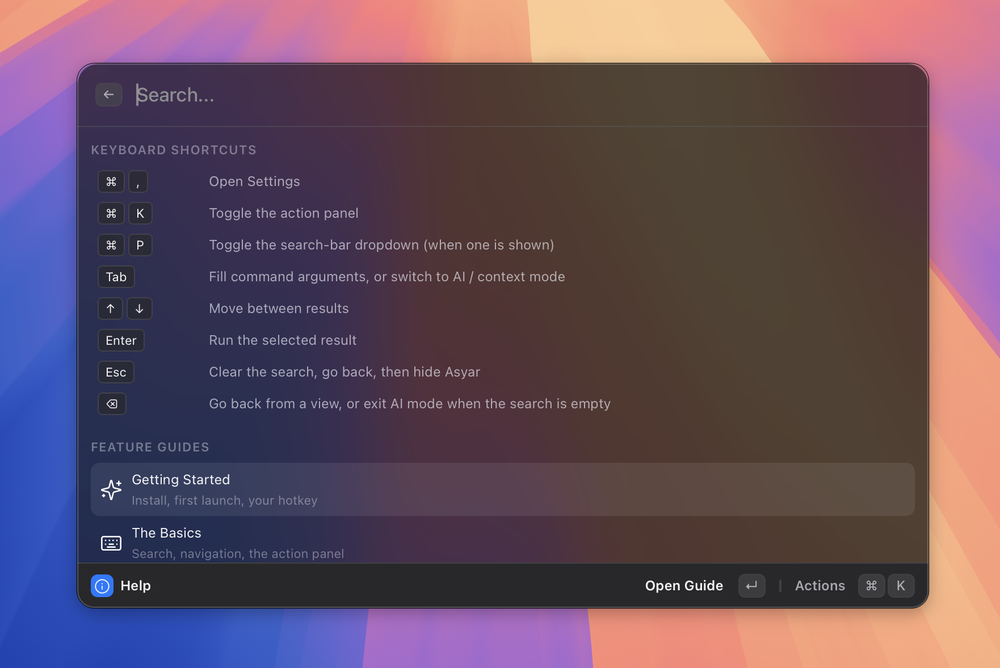

# Keyboard Shortcuts

> Every Asyar shortcut in one place. The same list appears in-app under "Help".

_Figure: the in-app Help view cheat sheet._

## Global

These shortcuts work anywhere inside the Asyar launcher window.

| Shortcut                          | What it does                                           |
| --------------------------------- | ------------------------------------------------------ |
| The hotkey you chose during setup | Show or hide Asyar from anywhere on your computer      |
| `⌘,`                              | Open Settings                                          |
| `⌘K`                              | Toggle the action panel                                |
| `⌘P`                              | Toggle the search-bar dropdown (when one is shown)     |
| `@`                               | Scope search exclusively to runnable commands          |
| `Tab`                             | Fill command arguments, or switch to AI / context mode |
| `↑` / `↓`                         | Move between results                                   |
| `Enter`                           | Run the selected result                                |
| `Esc`                             | Clear the search → go back from a view → hide Asyar    |

The show/hide hotkey is user-configurable in **Settings → Shortcuts**.

**Hyper Key (`✦`) Support:** If you configure a shortcut using all four modifiers (`Ctrl + Alt + Shift + Cmd/Super`), Asyar renders the combination with the clean `✦` glyph (e.g. `✦Space`).

**Standalone Function Keys (`F1`–`F24`):** Function keys (including extended keys `F13`–`F24` and the Windows Copilot key `F23`) can be assigned as hotkeys directly without requiring modifiers.

With an empty search field and the first result selected, press `↑` to recall the most recent query. Keep pressing `↑` for older queries and `↓` to move back toward an empty field. Asyar saves a query when you use a result or clear the field with `Esc`.

**Windows & Linux:** Action shortcuts (everything listed under _In a view_ and _Per-feature_, and the hints in the `⌘K` panel) adapt to your platform: **⌘** on macOS is **Ctrl** on Windows and Linux, so `⌘N` is `Ctrl+N` there. The tables below are written with the macOS symbols. Global hotkeys you record yourself keep the exact keys you pressed.

**Linux on Wayland:** Because Wayland protocol security blocks background hotkey grabs, assign your shortcut inside your desktop compositor settings to run `asyar-summon` (for example, `bind = $mainMod, SPACE, exec, asyar-summon` in `~/.config/hypr/hyprland.conf`, `hl.unbind("SUPER + SPACE")` + `o.bind("SUPER + SPACE", "Asyar", "asyar-summon")` in `~/.config/hypr/bindings.lua` on Omarchy v4+, or `unbind = SUPER, SPACE` + `bindd = SUPER, SPACE, Asyar, exec, asyar-summon` in `~/.config/hypr/bindings.conf` on Omarchy v3). Executing `asyar-summon` while the daemon is running acts as an instant D-Bus toggle.

## In a view

These shortcuts apply when you have drilled into a result that opens a full view (for example, Clipboard History, Snippets, Window Switcher, or an AI agent conversation).

| Shortcut | What it does                                                                                |
| -------- | ------------------------------------------------------------------------------------------- |
| `⌫`      | Go back from the open view (when the search bar is empty), or exit AI mode                  |
| `Esc`    | Follows the Escape behaviour you configured: step backwards, hide window, or reset launcher |
| `⌘K`     | Toggle the action panel for the selected item in the view                                   |

You can change what `Esc` does when a view is open in **Settings → Advanced → Escape Key**:

- **Step Backwards** — clears the search first, then pops the view, then hides Asyar (the default).
- **Hide Window** — hides Asyar immediately without clearing state.
- **Reset Launcher** — hides Asyar and resets all state so the next open starts fresh.

## Per-feature

Built-in features declare Raycast-aligned shortcuts while their view is active. Every shortcut is shown next to its action in the `⌘K` panel and pressing it runs that action cleanly through the central dispatcher. Shortcuts do nothing while the `⌘K` panel or a dialog is open, and text-editing keys such as `⌘A`, `⌘C`, `⌘V`, `⌘Z`, and `⌘⌫` remain reserved for editing. Destructive actions (`⌃X` for single-item delete, `⌃⇧X` for bulk clear; `Ctrl+X` / `Ctrl+Shift+X` on Windows & Linux) always require confirmation (and on Windows/Linux, `Ctrl+X` cuts text whenever text is selected in the focused input).

**Root Search**

| Shortcut | What it does                                        |
| -------- | --------------------------------------------------- |
| `⌘⇧F`    | Add / Remove favorite (Apps & Commands)             |
| `⌘.`     | Pin / Unpin selected file                           |
| `⌘R`     | Reveal selected application or file in Finder       |
| `⌘⇧C`    | Copy Path (Apps/Files), Deeplink (Commands), or URL |
| `⌘⇧E`    | View all commands of the selected extension         |
| `⌘⇧,`    | Configure selected extension settings               |
| `⌃X`     | Uninstall selected app or Trash file (with confirm) |

**Notes**

| Shortcut | What it does                  |
| -------- | ----------------------------- |
| `⌘N`     | Create a note                 |
| `⌘.`     | Pin / Unpin the selected note |
| `⌘D`     | Duplicate the selected note   |
| `⌘⇧C`    | Copy note as Markdown         |
| `⌃X`     | Delete the selected note      |

**Snippets**

| Shortcut | What it does                              |
| -------- | ----------------------------------------- |
| `↵`      | Paste the selected snippet                |
| `⌘↵`     | Save form / submit changes in edit views  |
| `⌘N`     | Create a new snippet                      |
| `⌘E`     | Edit the selected snippet                 |
| `⌘D`     | Duplicate the selected snippet            |
| `⌘⇧P`    | Insert dynamic placeholder (when editing) |
| `⌘⇧C`    | Copy snippet expansion                    |
| `⌘.`     | Pin / Unpin the selected snippet          |
| `⌃X`     | Delete the selected snippet               |
| `⌃⇧X`    | Clear all snippets                        |

**Clipboard History**

| Shortcut                      | What it does                               |
| ----------------------------- | ------------------------------------------ |
| `↵`                           | Paste selected item (or merge & paste)     |
| `⌘↵`                          | Copy selected item to clipboard            |
| `⌃⌘↵` (`Ctrl+Shift+↵` Win/Ln) | Paste as plain text                        |
| `⌘↑` / `⌘↓`                   | Extend selection for merged paste          |
| `⌘.`                          | Pin / Unpin the selected item              |
| `⌘O`                          | Open URL item in browser                   |
| `⌘S`                          | Save text item as snippet                  |
| `⌘I`                          | Ask AI about selected text                 |
| `⌃X`                          | Delete selected item (with confirmation)   |
| `⌃⇧X`                         | Clear clipboard history (non-pinned items) |

**AI & Agents**

| Shortcut | What it does                                          |
| -------- | ----------------------------------------------------- |
| `⌘N`     | Create a new agent (Agents view) / Start a new thread |
| `⌘E`     | Edit the selected agent (Agents view)                 |
| `⌃X`     | Delete selected agent or thread (with confirmation)   |
| `⌘.`     | Pin / Unpin active thread (Chat view)                 |
| `⌘⇧C`    | Copy the assistant's last reply (Chat view)           |
| `Enter`  | Send user message or follow-up prompt (Chat view)     |
| `↵`      | Open agent run in chat (Recent Runs view)             |
| `⌃⇧X`    | Clear recent runs (Recent Runs view)                  |

**Window Management**

| Shortcut | What it does                                    |
| -------- | ----------------------------------------------- |
| `↵`      | Switch to selected window / Apply saved layout  |
| `⌘W`     | Close the selected window                       |
| `⌘⇧C`    | Copy the window title                           |
| `⌘N`     | Save the current window layout (Manage Layouts) |
| `⌘R`     | Rename the selected layout                      |
| `⌃X`     | Delete the selected layout (with confirmation)  |
| `⌘K`     | Open actions for the selected window or layout  |

**File Search**

| Shortcut     | What it does                                                           |
| ------------ | ---------------------------------------------------------------------- |
| `↵`          | Open selected file (File Search view)                                  |
| `⌘Y`         | Quick Look preview of selected file in main search (preserves `Space`) |
| `Space`      | Quick Look preview of selected file (in dedicated File Search view)    |
| `⌘R`         | Reveal in Finder / File Explorer                                       |
| `⌘⇧C`        | Copy Path                                                              |
| `⌘⌥C`        | Copy Name                                                              |
| `⌘T`         | Open in Terminal                                                       |
| `⌘.`         | Toggle Pin                                                             |
| `Tab` / `⌘I` | Send to Asyar AI                                                       |
| `⌘⇧F`        | Search Everywhere (deep OS-native search)                              |
| `⌃X`         | Move to Trash (with confirmation)                                      |
| `⌃⇧X`        | Clear File Search history (File Search view)                           |

**Screen OCR**

| Shortcut | What it does                                  |
| -------- | --------------------------------------------- |
| `Esc`    | Cancel interactive screen selection crosshair |

**Portals, Scripts, MCP, Store, Shortcuts & Help**

| Feature         | Shortcut | What it does                                |
| --------------- | -------- | ------------------------------------------- |
| Portals         | `⌘↵`     | Save portal form                            |
| Portals         | `⌘N`     | Create a new portal                         |
| Portals         | `⌘E`     | Edit selected portal                        |
| Portals         | `⌘D`     | Duplicate selected portal                   |
| Portals         | `⌃X`     | Delete selected portal (with confirmation)  |
| Script Commands | `↵`      | Run selected script (or make executable)    |
| Script Commands | `⌘R`     | Reveal selected script in Finder            |
| Script Commands | `⌘⇧C`    | Copy selected script path                   |
| MCP Servers     | `⌘N`     | Install MCP server                          |
| MCP Servers     | `⌘T`     | Test MCP server connection (Install form)   |
| MCP Servers     | `⌘R`     | Refresh MCP server status                   |
| MCP Permissions | `⌃X`     | Revoke selected tool permission             |
| Store           | `↵`      | Install / Update / Run selected extension   |
| Store           | `⌘⇧,`    | Open extension preferences (Detail view)    |
| Store           | `⌃X`     | Uninstall extension (Detail view)           |
| Store           | `⌘O`     | Open extension page in web browser          |
| Shortcuts       | `⌘E`     | Change global shortcut                      |
| Shortcuts       | `⌃X`     | Remove global shortcut (with confirmation)  |
| AI Builder      | `↵`      | Open created extension (Created Extensions) |
| AI Builder      | `⌘O`     | Open created extension directory in editor  |
| Help            | `⌘O`     | Open User Guide                             |

For all other features, use `⌘K` to open the action panel — every available action for the selected item is listed there.

## Related

- [The Basics](./the-basics.md)
- [Getting Started](./getting-started.md)
- [Settings](./settings.md)
- [Window Management](./features/window-management.md)
- [Screen OCR](./features/screen-ocr.md)
